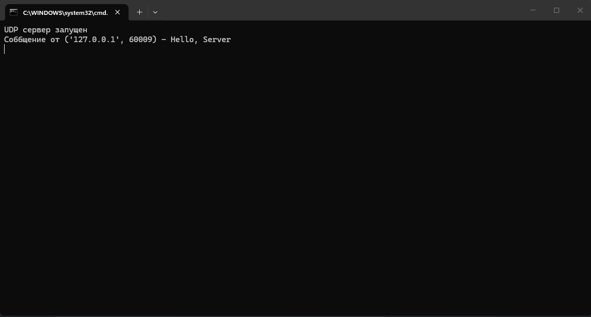
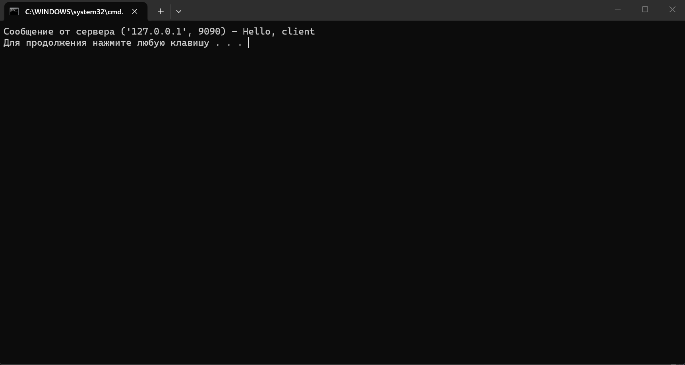
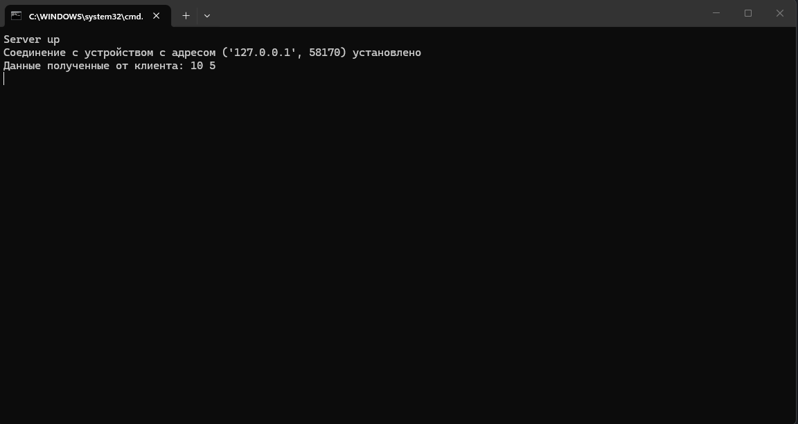
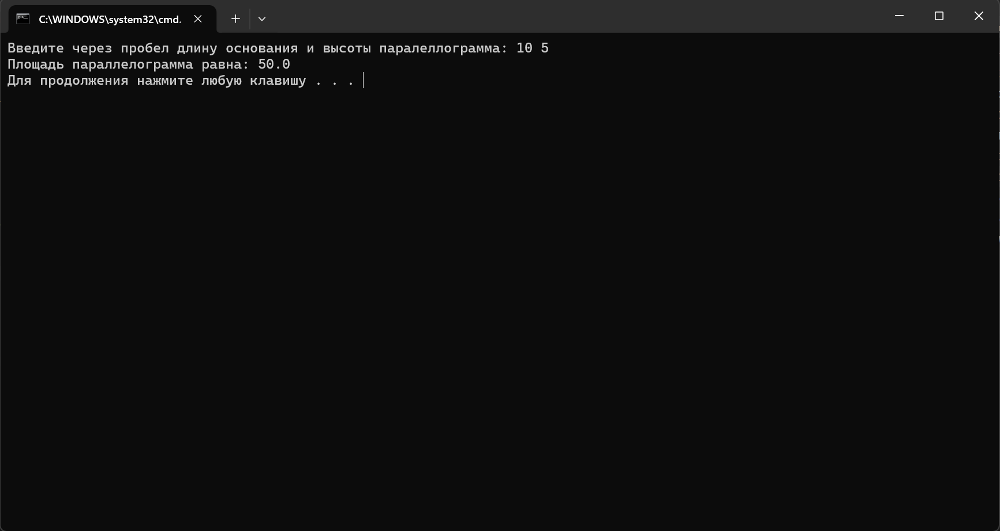

# Лабораторная работа №1

---

## 1. Обмен сообщениями по UDP


> **Требования:**

> 1.  Обязательное спользование библиотеки ```socket```
> 2.  Реализация через протокол ```UDP```


 **Задание:**
```
Реализовать клиентскую и серверную часть приложения. 
Клиент отправляет серверу сообщение «Hello, server», 
и оно должно отобразиться на стороне сервера. В ответ сервер 
отправляет клиенту сообщение «Hello, client», 
которое должно отобразиться у клиента.
```


### Написание серверной части

Код будет состоять из двух файлов. В первом из них будут заданы команды для сервера. 
Ниже привожу полный код серверной части:

```
import socket

sock = socket.socket(socket.AF_INET, socket.SOCK_DGRAM)
sock.bind(('', 9090))
print("UDP сервер запущен")

while True:
    data, client_info = sock.recvfrom(1024)
    if not data:
        break

    client_message = data.decode('utf-8')
    print(f"Соббщение от {client_info} - {client_message}")

    response = "Hello, client"
    sock.sendto(response.encode('utf-8'), client_info)

sock.close()
input()

```

*Пояснение:* 

С помощью библиотеки ```socket``` создан объект розетки. Во второй строке кода параметры в скобках
указывают на то, что это именно ```UDP``` socket, это необходимо указать, так как по умолчанию команда
```socket.socket()``` создаёт ```TCP``` socket. Далее розетка назначена слушать порт ```9090``` и любое
устройство, которое хочет подключиться по этому порту. После выводится сообщение и том, что сервер запущен.
Далее с помощью команды ```recvfrom``` в цикле, socket слушает порт и принимает данные поступающие в него.
Данные приходят кортежем ```(сообщение, хост и адрес устройства)```, этот кортеж разбивается и записывается в
2 переменные. Далее сообщение расшифровываетя и выводится на экран.

После получения сообщения сервер отправляет зашифрованный в байты ответ и закрывает прослушивание порта.


### Написание клиентской части:

Здесь проще, порт прослушивать не надо, только написать соощение и указать адрес, на который необходимо его доставить, а затем получить и расшифровать ответ сервера.

Ниже привожу полный код клиентской части:

```
import socket

sock = socket.socket(socket.AF_INET, socket.SOCK_DGRAM)

server_address = ('localhost', 9090)
message = "Hello, Server"

sock.sendto(message.encode('utf-8'), server_address)

data, server_info = sock.recvfrom(1024)
sock.close()

print(f"Сообщение от сервера {server_info} - {data.decode('utf-8')}")
```

*Пояснение:*

Снова создан ```socket``` и указан адрес сервера. В этот раз важно указать, что сервер это ```localhost```. Затем сообщение от клиента переводится в байты и
отправляется по адресу сервера. Потом с помощью той же команды ```recvfrom``` читается ответ от сервера, который далее переводится в читаемую строку и выводится на экран.


### Результат:
Сначала запустим сервер, после получения сообщения о том, что он работает, запустим клиентский код и посмотим на результат:

*Сервер:*





*Клиент:*




Клиент отправил сообщение на сервер, сервер его получил, вывел, написал ответ, отправил его, клиент получил ответ и тоже его вывел. Первое практическое задание успешно выполнено.

---

## 2. Вычисления через TCP


> **Требования:**

> 1. Обязательное использование библиотеки socket

> 2. Реализация с помощью протокола TCP

> 3. Необходимая операция - поиск площади параллелограмма (так как номер в журнале - 36)

**Задание:**
```
Реализовать клиентскую и серверную часть приложения. Клиент запрашивает 
выполнение математической операции, параметры которой вводятся с клавиатуры. 
Сервер обрабатывает данные и возвращает результат клиенту.
```


### Написание серверной части:

Снова начинаем писать код с серверной части.

Сначала с помощью библиотеки ```socket``` создаем розетку и говорим ей слушать порт ```9090```, но на этот раз socket создается с другим аргументом, соответствующем розетке с ```TCP``` передачей данных. Ниже блок кода с вышеописанными операциями:

```
import socket

sock = socket.socket(socket.SOCK_STREAM)

sock.bind(('', 9090))

print("Server up")
```

Далее заставляем socket слушать на порту и когда соединение с клиентом установлено выводим сообщение об этом с адресом клиента. 

Код:

```
sock.listen(1)
client_sock, client_address = sock.accept()
print(f"Соединение с устройством с адресом {client_address} установлено")
```


Затем дожидаеся данных от клиента, с помощью ```try``` и ```catch``` проверяем валидность полученных данных и считаем площадь параллелограмма. Если все успешно, возвращаем результат клиенту, если нет - клиенту возвращаем сообщения об ошибках.

Код:

```
while True:
    client_data = client_sock.recv(1024)
    if not client_data:
        break
    recived_data = client_data.decode('utf-8')
    print(f"Данные полученные от клиента: {recived_data}")

    try:
        parts = recived_data.split()
        if len(parts) == 2:
            osnovanie = float(parts[0])
            vysota = float(parts[1])

            S = osnovanie*vysota

            client_sock.sendall((f"Площадь параллелограмма равна: {S}").encode('utf-8'))
        else:
            client_sock.sendall(("Должно быть введено 2 числа через проблем").encode('utf-8'))
    except:
        client_sock.sendall((f"Неверный формат следующих данных: {recived_data}").encode('utf-8'))

client_sock.close()
sock.close()
input()
```

На этом код сервера завершен.


### Написание клиентской части:

С ней все снова значительно проще. Создаем ```socket```, соединяем его с сервером по порту, читаем данные с клавиатуры, кодируем в биты, отправляем на сервер.
Затем получаем ответ от сервера, декрдиуем в читаемый вид и выводим на экран.

Код:

```
import socket

sock = socket.socket(socket.AF_INET, socket.SOCK_STREAM)
sock.connect(('localhost', 9090))

data = input("Введите через пробел длину основания и высоты паралеллограмма: ")
message = data.encode('utf-8')

sock.send(message)

S = sock.recv(1024)
result = S.decode('utf-8')

print(result)

sock.close()
```

### Результат:

Серверная часть:




Клиентская часть:




Данные введены со стороны клиента, отправлены на сервер, проверены на корректность, с ними проделаны операции, результат операций отправлен клиенту. Результат корректен. На этом работа над вторым практическим заданием завершена.


---
## 3. Раздача HTML страницы по HTTP

> **Требования:** 

> - Обязательно использовать библиотеку socket

**Задание:**

```
Реализовать серверную часть приложения. Клиент подключается к серверу и в ответ 
получает HTTP-сообщение, содержащее HTML-страницу, которую сервер подгружает из 
файла index.html.
```


### Подготовка:

Перед написанием кода сервера я создал файл ```index.html``` в той же директории, где будет сервер.
Код для html файла я попросил написать нейросеть, чтобы результат был интереснее, чем просто текст. 
Таким образом у меня получилась следующая html-страница:


### Написание серверной части:

Начало стандартное, за исключением того, что теперь метод ```sock.listen()``` имеет в качестве параметра 5.
Так как теперь в качестве клиента выступает реальный браузер, а не рукописный клиент, я не могу гарантировать, что
от клиента будет приходить лишь 1 подключение одновременно. Поэтому начала кода теперь выглядит так:

```
import socket

sock = socket.socket(socket.AF_INET, socket.SOCK_STREAM)
sock.bind(('', 9095))
sock.listen(5) 
print("Сервер поднят и готов принять запрос")
```


Далее сразу запускаем цикл ```while True:```. В отличие от предыдущих версий сервера, в этой прием пожключения
через ```socket.accept``` и получение данных через ```sock.recv``` происходят внутри цикла. Это сделано, чтобы
сервер не закачивал работать сразу после того как 1 подключение завершилось, по той же причине, теперь клиент - реальный браузер.

Код:

```
while True:
    client_sock, client_address = sock.accept() # теперь сервер будет обслуживать ни 1 клиента на протяжении всей своей работы, а всех желающих
    request = client_sock.recv(1024)
    if not request:
        client_sock.close() # если браузер открыл подключение и ничего не прислал теперь просто ждем следующего подключения, а не закрываем сокет сервера
        continue

    print(f"Сервер получил запрос от {client_address}:\n{request.decode('utf-8')[:100]}... \n") # первые 100 символов запроса
```


Теперь содержательная часть работы сервера. Если подключение успешно состоялось и запрос получен, пытаемся прочитать 
содержимое файла ```index.html```. В любом случае пытаемся достать тело этого файла, если же сам файл не найден, то 
вместо тела в соответствующую переменную пишем текст ошибки тоже в ```html-формате```.

Код:
```
try:
    with open('index.html', 'r', encoding='utf-8') as file:
        body = file.read()
except FileNotFoundError:
    body = "<h1>Файл index.html не найден<h1>" # оборачиваем текст ошибки в тело HTTP ответа
```


Сейчас у нас есть тело для ```HTTP-ответа``` от сервера, но для передачи его недостаточно, нужны еще и заголовки.
Поэтому сначала считаем длину тела ответа в байтах, так как эту информацию надо будет передать в заголовке. И пишем
заголовки в стандартной форме:

```
content_length = len(body.encode('utf-8'))

response_headers = (
    "HTTP/1.1 200 OK\r\n"
    "Content-Type: text/html; charset=utf-8\r\n"
    f"Content-Length: {content_length}\r\n"
    "Connection: close\r\n"
    "\r\n"
    )
```

В первой строке заголовка пишется тип передачи, в нашем случае по ```HTTP протоколу```.

Во второй строке пишем какое содержимое мы передаем клиенту. В нашем случае текст в формате html
и набором символов в ```utf-8```.

В третьей строке указывается длина передаваемого тела запроса, которую мы считали ранее.

В 4 строке указываем, что делать с соединением после передачи запроса. Мы хотим, чтобы подключение закрылось.

И в 5 строке обязательно ставится перенос строки, так как это требования формата заголовков.


Остается соединить заголовки с телом ответа. И отправить ```HTTP-ответ``` клиенту. 

Код:

```
    response = response_headers + body
    client_sock.sendall(response.encode('utf-8'))

    client_sock.close()
```


Тут для удобства проверки приведу весь код сервера:

```
import socket

sock = socket.socket(socket.AF_INET, socket.SOCK_STREAM)
sock.bind(('', 9095))
sock.listen(5) 

print("Сервер поднят и готов принять запрос")

while True:
    client_sock, client_address = sock.accept() # теперь сервер будет обслуживать ни 1 клиента на протяжении всей своей работы, а всех желающих
    request = client_sock.recv(1024)
    if not request:
        client_sock.close() # если браузер открыл подключение и ничего не прислал теперь просто ждем следующего подключения, а не закрываем сокет сервера
        continue

    print(f"Сервер получил запрос от {client_address}:\n{request.decode('utf-8')[:100]}... \n") # первые 100 символов запроса


    try:
        with open('index.html', 'r', encoding='utf-8') as file:
            body = file.read()
    except FileNotFoundError:
        body = "<h1>Файл index.html не найден<h1>" # оборачиваем текст ошибки в тело HTTP ответа

    content_length = len(body.encode('utf-8'))

    response_headers = (
        "HTTP/1.1 200 OK\r\n"
        "Content-Type: text/html; charset=utf-8\r\n"
        f"Content-Length: {content_length}\r\n"
        "Connection: close\r\n"
        "\r\n"
        )


    response = response_headers + body
    client_sock.sendall(response.encode('utf-8'))

    client_sock.close()

```


### Проверка:

Поднимаем сервер и открываем браузер. В браузере переходим по адресу ``` http:\\localhost:9095````. И проверяем.

Так выглядит страница со стороны клиента:


Видим, что страница успешно передана клиенту.


Со стороны сервера вывод выглдит так:


### Итог:

Клиент отправил запрос по адресу сервера. Сервер его получил, прочитал, в файле ```index.html``` нашел содержимое, обернул тело в заголовки и отправил все клиенту.
Задание 3 выполнено.

*Только я не понял почему в терминале сервера у connection статус keep-alive, если в заголовке я передавал команду на закрытие подключения. Но это загадка, ответа на которую я не нашел.*


---
## 4. Чат на сокетах


> **Требования:**

> - Обязательно использовать библиотеку socket

> - Для многопользовательского чата обязательно использовать библиотеку threading

> - Организация возможности идентификации пользователей

> - Обеспечение возможности пользователю выйти из чата

> - выполнить с помощью протокола TCP


**Задание:**

```
Реализовать двухпользовательский или многопользовательский чат. 
Для максимального количества баллов реализуйте многопользовательский 
чат.
```


### Справка:

Перед выполнением этого задания я почитал как подобные чаты организуются на реальных серверах. 
Оказалось, что это делается не с помощью потоков, а с помощью ассинхронности. Вместо создания 
новых потоков сервер очень быстро переключается меду сокетами и если сокет ничего не передает,
то сервер им не занимается. Реализация чата с помощью библиотеки ```threading``` будет хорошо
работать только в подобном задании, где нагрузка на сервер меньше 10 тысяч единовременных 
подключений.


### План выполнения:

Сначала я напишу серверную часть кода, соответствующую требованиям. Затем напишу клиентскую часть,
которая будет просить пользователя ввести его имя, затем я запущу клиентский код в нескольких
экземплярах и проверяю как правляется сервер.


### Написание серверной части:

Пишем стандартное начало: указываем хост и порт сервера и создаем 2 глобальных списка для клиентских сокетов и никнеймов.

```
from pydoc import cli
import socket
import threading

HOST = ''
PORT = 9080

clients = []
nicknames = []
```


Пишем функцию массовой рассылки. Она будет принимать на вход 2 аргумента. Первый - сообщение, которое надо передать пользователям, второй - порт клиентского сокета.
Второй аргумент может быть пустым, если сообщение нужно отослать от имени сервера, а не пользователя вообще всем клиентам.

```
def send_to_all(message, sender_socket = None):
    for client in clients:
        if client != sender_socket:
            try:
                client.send(message)
            except:
                pass # если сокет почему-то не работает
```


Теперь пишем самую большую функцию ```for_one_client```, которая будет инициализировать пользователей, сохранять их имена, их сокеты,
принимать их сообщения, рассылать сообщения остальным и держать нас в курсе о статусе клиента: присоединился или покинул.

Функция написана с помощью ```try```, ```except``` и ```finally``` блоков. В блоке try сервер отпраляет клиенту требование авторизоваться,
записывает его в свои списки, оповещает всех о присоединении нового пользователя. Затем читает все входящие сообщения от этого пользователя,
превращает их сообщения в формат ```пользователь: сообщение``` и с помощью первого метода отсылает их остальным клиентам.

В блоке except метод ловит любые виды ошибок, связанных с разрывом соединения с клиентом и дает нам возможность посмотреть логи.

В блоке finally метод обрабатывает выход пользователя из чата стандартным способом, то есть в моем случае, если пользователь
закрыл свой терминал и тем самым разорвал подключение. Метод удаляет клиента из своих списков, уведомляет всех пользователей о выходе и
освобождает сокет.

```
def for_one_client(client_socket):
    try:
        client_socket.send("Nickname_Request".encode('utf-8'))
        nickname = client_socket.recv(1024).decode('utf-8')
        nicknames.append(nickname)
        clients.append(client_socket)
        print(f"Пользователь сохранен как: {nickname}")
        send_to_all(f"Пользователь {nickname} присоединился к чату".encode('utf-8'), sender_socket=client_socket)
    
        while True:
            raw_message = client_socket.recv(1024)
            if not raw_message:
                break
            
            message = raw_message.decode('utf-8')
            user_message = f"{nickname}: {message}".encode('utf-8')
            send_to_all(user_message, sender_socket=client_socket)
    except Exception as e:
        print(f"Ошибка с клиентом {e}")

    finally:
        if client_socket in clients:
            index = clients.index(client_socket)
            clients.remove(client_socket)
            client_socket.close()
            nickname = nicknames[index]
            nicknames.remove(nickname)

            exit_massage = f"Пользователь {nickname} покинул чат".encode('utf-8')
            print(exit_massage.decode('utf-8'))
            send_to_all(exit_massage)
```


Ну и метод запуска главного потока сервера ```start_server()```. В этом блоке я поймал больше всего ошибок при тестировании кода.
Главный принцип написания главного потока - он должен **только** раздавать каждому клиентскому сокету свой поток. 
Нельзя давать ему никаких доп задач, например, я сначала пытался сделать авторизацию пользователя именно здесь, что
в итоге просто морозило мой главный поток и ни 1 другой клиент не мог ничего сделать, пока первый клиент вводил имя.

Поэтому этот метод просто создает сокет сервера, который слушает все подключения. Как только серверный сокет
принял подключение, он сразу передает клиентский сокет потоку и освобождается для принятия нового соединения.

```
def start_server():
    server = socket.socket(socket.AF_INET, socket.SOCK_STREAM)
    server.setsockopt(socket.SOL_SOCKET, socket.SO_REUSEADDR, 1) # для мгновенного освобождения порта сервера
    server.bind((HOST, PORT))
    server.listen()
    print("Сервер запущен и ждет подключений")

    while True:
        client_socket, client_address = server.accept()
        print(f"Новое соединение с адресом: {str(client_address)}")

        thread = threading.Thread(target=for_one_client, args = (client_socket,))
        thread.start()


if __name__ == "__main__":
    start_server()
```

На этом написание кода для сервера завершено.


### Написание клиентской части:

Тут как обычно все намного проще.

Создаем сокет, пытаемся подключиться к серверу, если не удалось - сообщаем об этом и завершаем выполнение.

```
import socket
import threading
import sys
import time

client = socket.socket(socket.AF_INET, socket.SOCK_STREAM)

try:
    client.connect(('127.0.0.1', 9080))
except ConnectionRefusedError:
    print("Не удалось соединиться с сервером")
    sys.exit()
```


Далее вводим глобальную переменную ```authentificated``` и устанавливаем её занчение в ```False```.
Она будет нужна далее для того, чтобы обеспечить возможность писать в чате только авторизованым пользователям.

```
authentificated = False
```


Далее пишем метод ```recive_massages```, через который клиент сможет авторизоваться на сервере, получив от него соотвествующее требование,
и просто сможет видеть, полученные от сервера сообщения. Тут простая логика: если сервер отправил запрос на авторизацию, клиенту будет
предложено ввести свой ник, который отправится на сервер и изменит значение переменной ```authentificated``` и даст возмоность самому писать сообщения,
если же сервер просто прислал соощение, то пользователь его увидит у себя.

```
def recive_messages():
    global authentificated
    while True:
        try:
            message = client.recv(1024).decode('utf-8')
            if message == 'Nickname_Request':
                nickname = input('Сервер запрашивает имя пользователя: ')
                client.send(nickname.encode('utf-8'))
                authentificated = True
                print("Вы успешно авторизовались, для выхода из чата введите esc")
           
            else:
                print(message)
        except:
            print("Соединение с сервером потеряно")
            client.close()
            break
```


Далее обратный метод для отправки сообщений ```send_message()```. Метод крутится в 
бесконечном цикле с небольшим интервалом между итерациями, пока пользователь не введет свое имя и флаг 
```authentificated``` не примет значение ```True```. После этого пользователю будет предложено ввести текст, который
далее будет отправлен на сервер или же повлечет аварийное закрытие сессии.

```
def send_messages():
    while True:
        if not authentificated:
            time.sleep(0.1)
            continue

        raw_message = input("Введите текст: ")
        if raw_message.lower() == 'esc':
            client.close()
            sys.exit()

        try:
            client.sendall(raw_message.encode('utf-8'))
        except:
            break

```


Ну и в самом конце создаем потоки, чтобы методы работали параллельно и не блокировали друг друга.
(Тупо если сообщение с сервера не приходит, если пользователь параллельно пишет свое в input) При этом
процесс получения сообщений делаем фоновым, чтобы если пользватель закрыл сессию, клиентский код не дожидался
пока сервер отправит все сообщения, что у него есть.

```
threading.Thread(target=recive_messages, daemon = True).start() # фоновый процесс
threading.Thread(target=send_messages).start()
```


### Проверка:

Все, теперь как и планировалось, запускаю сервер и 3 клиентов одовременно.

Вот так выглядит первый этап со стороны сервера:


А вот так со стороны пользователей:


Видим, что имя запрашивается у всех одновременно, никто не блокирует основной поток.

Далее вводим имена и смотрим.

Вот так выглядит второй этап со стороны сервера:


А вот так со стороны клиентов:


Ну и в конце иммитируем небольшой диалог и выходим.

Клиентская часть:


Серверная часть:


### Заключение:

Это пока самое интересное из заданий этой лабораторной. Несмотря на то, что это не тот подход, который используется на реальных серверах,
это все равно оказалось очень полезно для понимания того как работает сервер, где вся логическая нагрузка перенесена на него.

---
## 5. Простой веб-сервер (GET/POST)

> ### Дисклеймер:
> Это было самым слоным из заданий, для него я изучил практики, которые используются в реальной жизни, например изменение
> хранящего на сервере шаблона html-страницы. Помимо этого я столкнулся с трудностями в парсинге и искал способ решения,
> которым оказалась отдельная библиотека. Поэтому на это задание я потратил больше времени, чем планировал и просрочил дедлайн на день.
> В общем, прошу принять эту работу без решенного лит кода, на него уже нет сил)


> ### Задание:

> Написать простой веб-сервер для обработки GET и POST HTTP-запросов с помощью библиотеки socket в Python. Сервер должен:

> - Принимать и записывать информацию о дисциплине и оценке по дисциплине.

> - Отдавать информацию обо всех оценках по дисциплинам в виде HTML-страницы.


### Выполнение:

Перед началом работы я изучил реальные практики для предоставления страницы с обновленными данными.
В реальной жизни на серверах хранится ```шаблон html-страницы```, в нем есть переменная, которую можно изменять
в коде сервера.

### Подгтовка:

Я попросил нейронку написать мне код для красивой html-страницы, в котром будет содержатся такая переменная.

Я получил от Gemini такой вариант:

```
<!DOCTYPE html>
<html lang="ru">
<head>
    <meta charset="utf-8">
    <title>Электронный журнал оценок</title>
    <style>
        body { font-family: Arial, sans-serif; margin: 40px; background-color: #f9f9f9; color: #333; }
        h1, h2 { color: #2c3e50; }
        form { background: white; padding: 20px; border-radius: 8px; box-shadow: 0 2px 4px rgba(0,0,0,0.1); max-width: 400px; }
        input[type="text"], input[type="number"] { width: 100%; padding: 8px; margin: 8px 0 16px 0; box-sizing: border-box; }
        button { background-color: #3498db; color: white; padding: 10px 15px; border: none; border-radius: 4px; cursor: pointer; }
        button:hover { background-color: #2980b9; }
        ul { list-style-type: none; padding: 0; }
        li { background: white; padding: 10px 15px; margin-bottom: 8px; border-radius: 4px; border-left: 5px solid #2ecc71; box-shadow: 0 1px 3px rgba(0,0,0,0.05); }
    </style>
</head>
<body>
    <h1>Электронный журнал</h1>
    
    <h2>Добавить новую оценку</h2>
    <form method="POST" action="/">
        <label for="subject">Дисциплина:</label>
        <input type="text" id="subject" name="subject" required placeholder="Например: Математика">
        
        <label for="mark">Оценка:</label>
        <input type="number" id="mark" name="mark" min="1" max="5" required placeholder="От 1 до 5">
        
        <button type="submit">Сохранить оценку</button>
    </form>

    <h2>Все оценки (сгруппированы по предметам):</h2>
    <ul>
        %MARKS_LIST%
    </ul>
</body>
</html>
```

Тут ```%MARKS_LIST%``` является переменной. Запомним это и в коде сервера будем собирать готовую страницу для отправки,
предварительно заменяя значение переменной на актуальной список оценок, хранящихся в словаре на сервере.


### Создание и бинд сокетов

Тут по стандарту, создаем серверный сокет, биндим на порт '9050' и ждем подключения:

```
import socket
from urllib.parse import parse_qs

marks_dict = {}

server = socket.socket(socket.AF_INET, socket.SOCK_STREAM)
server.setsockopt(socket.SOL_SOCKET, socket.SO_REUSEADDR, 1)
server.bind(('', 9050))
server.listen(5)
print("Сервер поднят по адресу http://localhost:9050 и ждет запрос")
```

При этом сервер я писал ориентируясь на версию из задания 4. Но тут упрощенная версия без потоков, которая, тем не менее может работать с несколькими клиентами.


### Парсинг запроса:

После установления соединения и получение запроса от клиента, нужно понять, что клиент хочет от сервера.

- Переводим запрос в читаемый текст из байтов

- Делим запрос на заголовки и тело, ориентируясь на пустую строку, которая их разделяет
При этом надо помнить о мусорных пакетах от браузера и проверять их на каждой итерации деления.
На этом этапе единственное о чем нужно помнить - не у каждого запроса есть заголовки и тело. 
Например, запрос ```GET``` идет без тела, в этом случае читаем только заголовки, а в тело записываем пустоту.

- Далее работаем с заголовками. Нас интересует первая строка. Делим заголовок на строки 

- Берем первую строку заголовка и снова делим на части

- Берем первую часть - это и есть метод, который просит от нас клиент ```POST``` или ```GET```
Вот тут находится главный обработчик мусорных пакетов ```if len(parts) < 2:
    client_socket.close()
    print("Пришел мусорный пакет")
    continue``` 

> При проверке сервера оказалось, что все эти проверки - оверкилл, за все время тестрования браузер не отправил ни одного мусорного пакета

Код парсинга заголовка выглдяит так:

```
while True:
    client_socket, client_address = server.accept()
    
    try:
        raw_request = client_socket.recv(2048)
        if not raw_request:
            client_socket.close()
            continue

        client_request = raw_request.decode('utf-8')

        if '\r\n\r\n' in client_request:
            request_headers, request_body = client_request.split('\r\n\r\n', 1)
        else:
            request_headers = client_request
            request_body = ''

        request_headers_lines = request_headers.splitlines()
        if not request_headers_lines:
            client_socket.close()
            continue

        request_headers_line = request_headers_lines[0]
        parts = request_headers_line.split()

        if len(parts) < 2:
            client_socket.close()
            print("Пришел мусорный пакет")
            continue

        method = parts[0]
```


### Обработка метода POST

Если клиент просит внести оценку в словарь сервера (он создан еще до цикл while, забыл упомянуть), то нам надо распарсить тело запроса.
Тело приходит в HTML формате. Чтобы сделать текст тела читаемым используем библиотеку ```urllib.parse```, конкртено метод ```parse_qs```.
После паринга делим уже читаемое тело запроса на 2 переменные: ```subjects``` и ```marks```. По дефолту значения этих переменных приходят списками.
Поэтому обрезаем эти списки по первому элементу и получаем предмет и оценку за него. Если предмета, оценку за который требуется поставить нет в словаре оценок,
то добавляем его и сразу за ним оценку, если есть - то просто оценку в соответствующий ключ. И пишем сообщение на сервере о том, что оценка поставлена.
В конце по форме пишем свои ```headers``` для ответа и отправляем клиенту, чтобы код не завис на POST и не слоался при вызове GET. Как оказалось при 
написании и проверке, если не отправить клиенту эти заголовки и попытаться перезагрузить страницу, запрос на POST будет выполняться каждый раз, но перед
этим появиться предупреждение "Вы уверены, что хотите отправить форму заново?", это было неприятно, зато я теперь понимаю в каких случаях браузер предупреждает об этом.

Код этой части:

```
 if method == 'POST':
     parsed_body = parse_qs(request_body) # библиотека для парсинга html запросов
     subjects = parsed_body.get('subject')
     marks = parsed_body.get('mark')

     if subjects and marks:
         subject = subjects[0].strip()
         mark = marks[0].strip()
         
         if subject not in marks_dict:
             marks_dict[subject] = []
         marks_dict[subject].append(mark)
         print(f"Добавлена оценка {mark} по предмету {subject}")

         response_headers = (
             "HTTP/1.1 303 See Other\r\n"
             "Location: /\r\n"
             "Connection: close\r\n"
             "\r\n"
         )

         client_socket.sendall(response_headers.encode('utf-8'))
```


### Обработка метода GET

Тут я столкнулся с наибольшим количеством трудностей просто потому что постоянно забывал, что все сообщения клиенту нужно оборачивать в ```html``` формат.

Здесь я создаю пустую строку, в которой буду формировать список оценок в формате html. Циклом пробегаю по всем ключам и для каждого заполняю строку marks_html.
Если предметы пока не добавлены, то просто отправляю сообщение о необходимости ввести хотя бы какие-то оценки. Далее возвращаемся к шаблону, созданному на этапе подготовки.
Я читаю его и заменяю в нем переменную ```%MARKS_LIST``` на переменную marks_html, которая хранит строку с актуальными оценками. Далее снова заголовки для ответа по шаблону,
соединение заголовков с телом, в котром лежит строка оценок в html формате и код html страницы и отправка клиенту.

И в конце главного цикла остается только закрыть сокет и прервать подключение.

Код этой части:

```
    else:
        marks_html = ""
        for sub, list_of_marks in marks_dict.items():
            str_marks = ", ".join(list_of_marks)
            marks_html += f"<li><b>{sub}</b>: {str_marks}</li>"
        if not marks_html:
            marks_html = "<li>В журнале нет оценок, сначала добавьте их</li>"

        try:
            with open('marks.html', 'r', encoding='utf-8') as f:
                html_template = f.read()
        except FileNotFoundError:
            html_template = "<h1>Файл marks.html не найден на сервере</h1>"

        final_html = html_template.replace("%MARKS_LIST%", marks_html)
        response_final = final_html.encode('utf-8')

        response_headers = (
            "HTTP/1.1 200 OK\r\n"
            "Content-Type: text/html; charset=utf-8\r\n"
            f"Content-Length: {len(response_final)}\r\n"
            "Connection: close\r\n"
            "\r\n"
        )

        client_socket.sendall(response_headers.encode('utf-8') + response_final)
except Exception as e:
    print(f"Ошибка при обработке запроса {e}")

finally:
    client_socket.close()
```


### Код целиком для удобного чтения:

```
import socket
from urllib.parse import parse_qs

marks_dict = {}

server = socket.socket(socket.AF_INET, socket.SOCK_STREAM)
server.setsockopt(socket.SOL_SOCKET, socket.SO_REUSEADDR, 1)
server.bind(('', 9050))
server.listen(5)
print("Сервер поднят по адресу http://localhost:9050 и ждет запрос")

while True:
    client_socket, client_address = server.accept()
    
    try:
        raw_request = client_socket.recv(2048)
        if not raw_request:
            client_socket.close()
            continue

        client_request = raw_request.decode('utf-8')

        if '\r\n\r\n' in client_request:
            request_headers, request_body = client_request.split('\r\n\r\n', 1)
        else:
            request_headers = client_request
            request_body = ''

        request_headers_lines = request_headers.splitlines()
        if not request_headers_lines:
            client_socket.close()
            continue

        request_headers_line = request_headers_lines[0]
        parts = request_headers_line.split()

        if len(parts) < 2:
            client_socket.close()
            print("Пришел мусорный пакет")
            continue

        method = parts[0]
        path = parts[1]

        if method == 'POST':
            parsed_body = parse_qs(request_body) # библиотека для парсинга html запросов
            subjects = parsed_body.get('subject')
            marks = parsed_body.get('mark')

            if subjects and marks:
                subject = subjects[0].strip()
                mark = marks[0].strip()
                
                if subject not in marks_dict:
                    marks_dict[subject] = []
                marks_dict[subject].append(mark)
                print(f"Добавлена оценка {mark} по предмету {subject}")

                response_headers = (
                    "HTTP/1.1 303 See Other\r\n"
                    "Location: /\r\n"
                    "Connection: close\r\n"
                    "\r\n"
                )

                client_socket.sendall(response_headers.encode('utf-8'))

        else:
            marks_html = ""
            for sub, list_of_marks in marks_dict.items():
                str_marks = ", ".join(list_of_marks)
                marks_html += f"<li><b>{sub}</b>: {str_marks}</li>"
            if not marks_html:
                marks_html = "<li>В журнале нет оценок, сначала добавьте их</li>"

            try:
                with open('marks.html', 'r', encoding='utf-8') as f:
                    html_template = f.read()
            except FileNotFoundError:
                html_template = "<h1>Файл marks.html не найден на сервере</h1>"

            final_html = html_template.replace("%MARKS_LIST%", marks_html)
            response_final = final_html.encode('utf-8')

            response_headers = (
                "HTTP/1.1 200 OK\r\n"
                "Content-Type: text/html; charset=utf-8\r\n"
                f"Content-Length: {len(response_final)}\r\n"
                "Connection: close\r\n"
                "\r\n"
            )

            client_socket.sendall(response_headers.encode('utf-8') + response_final)
    except Exception as e:
        print(f"Ошибка при обработке запроса {e}")

    finally:
        client_socket.close()
```


### Тестирование:

Поднимаю сервер. В браузере перехожу по его адресу, ввожу значения и смотрю на мгновенное обновление страницы.

Сторона клиента:


Сторона сервера:


Видим, что задание успешно выполнено. Клиент отправляет запросы POST с оценками и предметами, сервер обновляет словарь.
Сразу после клиент отправляет GET запрос и получает обновленную html-страницу с актуальными оценками.